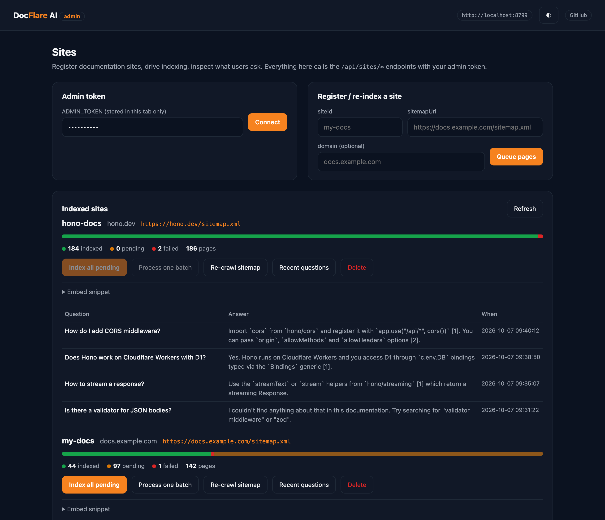

# DocFlare AI API Reference

Base URL: `https://docflare-ai.<your-subdomain>.workers.dev` (or your custom domain).

All request and response bodies are JSON unless stated otherwise. Timestamps are UTC ISO-8601.

## Authentication

| Route group                           | Requirement                                                                                                                                                |
|---------------------------------------|------------------------------------------------------------------------------------------------------------------------------------------------------------|
| `/api/sites/*`                        | `Authorization: Bearer <ADMIN_TOKEN>` (the secret set with `wrangler secret put ADMIN_TOKEN`)                                                              |
| `/api/chat`                           | No token. The request `Origin` must match the site's registered domain or an entry in `ALLOWED_ORIGINS`. Requests without an `Origin` header are accepted. |
| `/api/health`, `/widget.js`, `/admin` | None (the admin page asks for the token in the browser and sends it as a bearer header)                                                                    |

## Errors

Errors always have this shape:

```json
{ "error": "human readable message", "code": "machine_readable_code" }
```

| Status | Code                                                                 | When                                                    |
|--------|----------------------------------------------------------------------|---------------------------------------------------------|
| 400    | `invalid_json`, `invalid_site_id`, `invalid_url`, `invalid_question` | Malformed input                                         |
| 401    | `unauthorized`                                                       | Missing/invalid admin token                             |
| 403    | `origin_not_allowed`                                                 | `Origin` does not match the site's domain               |
| 404    | `site_not_found`, `not_found`                                        | Unknown site / route                                    |
| 422    | `crawl_error`                                                        | Sitemap unreachable, empty, or no same-domain HTML URLs |
| 429    | `ai_rate_limited`                                                    | Workers AI quota or rate limit hit (`Retry-After: 60`)  |
| 503    | `admin_token_missing`                                                | `ADMIN_TOKEN` secret not configured                     |
| 500    | `internal_error`                                                     | Unexpected failure (details in Worker logs)             |

`siteId` values are case-insensitive and normalised to lowercase. Pattern: `^[a-z0-9][a-z0-9_-]{0,63}$`.

---

## `GET /api/health`

Liveness probe.

```json
{
  "ok": true,
  "service": "docflare-ai",
  "models": { "embedding": "@cf/baai/bge-small-en-v1.5", "chat": "@cf/meta/llama-3.1-8b-instruct-fp8" },
  "time": "2026-10-07T09:00:00.000Z"
}
```

---

## `GET /api/sites`

All registered sites with their indexing progress. Powers the admin UI.

```json
{
  "sites": [
    {
      "id": "my-docs",
      "domain": "docs.example.com",
      "sitemap_url": "https://docs.example.com/sitemap.xml",
      "created_at": "2026-10-07 09:00:00",
      "progress": { "siteId": "my-docs", "total": 142, "pending": 97, "indexed": 44, "failed": 1 }
    }
  ]
}
```

---

## `POST /api/sites/index`

Register (or refresh) a site and queue every HTML URL found in its sitemap. Existing pages are reset to `pending`, so calling this again re-crawls the whole site.

**Request**

```json
{
  "siteId": "my-docs",
  "sitemapUrl": "https://docs.example.com/sitemap.xml",
  "domain": "docs.example.com",
  "process": false
}
```

| Field        | Type    | Required | Notes                                                                                     |
|--------------|---------|----------|-------------------------------------------------------------------------------------------|
| `siteId`     | string  | yes      | Slug, 1-64 chars                                                                          |
| `sitemapUrl` | string  | yes      | Absolute `http(s)` URL of a sitemap or sitemap index (`.xml` or `.xml.gz`)                |
| `domain`     | string  | no       | Hostname allowed to embed the widget and crawl scope. Defaults to the sitemap's hostname. |
| `process`    | boolean | no       | When `true`, also crawl one batch of pages inline before responding.                      |

**Response `202 Accepted`**

```json
{
  "siteId": "my-docs",
  "domain": "docs.example.com",
  "sitemapUrl": "https://docs.example.com/sitemap.xml",
  "queued": 142,
  "progress": { "siteId": "my-docs", "total": 142, "pending": 142, "indexed": 0, "failed": 0 },
  "processed": null,
  "next": "Pending pages are crawled 3 at a time by the cron trigger. Call POST /api/sites/my-docs/process repeatedly to finish faster."
}
```

`processed` contains a [process result](#post-apisitessiteidprocess) when `process: true` was sent.

**Example**

```bash
curl -X POST "$WORKER_URL/api/sites/index" \
  -H "Authorization: Bearer $ADMIN_TOKEN" \
  -H "Content-Type: application/json" \
  -d '{"siteId":"my-docs","sitemapUrl":"https://docs.example.com/sitemap.xml"}'
```

---

## `POST /api/sites/:siteId/process`

Crawl, chunk, embed and store the next `INDEX_BATCH_SIZE` pending pages for the site. Call repeatedly until `progress.pending` is `0`. The cron trigger performs the same work automatically once a minute.

**Response `200 OK`** (or `429` when Workers AI rate-limited the batch; remaining pages stay queued)

```json
{
  "processed": 3,
  "indexed": 2,
  "failed": 1,
  "rateLimited": false,
  "results": [
    { "url": "https://docs.example.com/intro", "status": "indexed", "title": "Introduction", "chunks": 4 },
    { "url": "https://docs.example.com/install", "status": "indexed", "title": "Installation", "chunks": 7 },
    { "url": "https://docs.example.com/old", "status": "failed", "error": "Failed to fetch https://docs.example.com/old: HTTP 404" }
  ],
  "progress": { "siteId": "my-docs", "total": 142, "pending": 139, "indexed": 2, "failed": 1 }
}
```

---

## `GET /api/sites/:siteId/status`

```json
{
  "site": {
    "id": "my-docs",
    "domain": "docs.example.com",
    "sitemap_url": "https://docs.example.com/sitemap.xml",
    "created_at": "2026-10-07 09:00:00"
  },
  "progress": { "siteId": "my-docs", "total": 142, "pending": 0, "indexed": 140, "failed": 2 }
}
```

---

## `GET /api/sites/:siteId/queries`

Recent chat log for a site, newest first. Query parameter `limit` (1-100, default 20).

```json
{
  "siteId": "my-docs",
  "queries": [
    {
      "id": "6f1c0e6e-5a4b-4f3b-9d1e-2c7a0b9f8e11",
      "site_id": "my-docs",
      "prompt": "How do I deploy to production?",
      "response": "Run `bun run deploy` …",
      "created_at": "2026-10-07 09:40:12"
    }
  ]
}
```

---

## `DELETE /api/sites/:siteId`

Removes the site row, its pages, its chat history and every vector in its namespace.

```json
{ "siteId": "my-docs", "deleted": true, "vectorsDeleted": 611 }
```

---

## `POST /api/chat`

Answer a question using the site's indexed content.

**Request**

```json
{
  "siteId": "my-docs",
  "question": "How do I deploy to production?",
  "stream": true,
  "history": [
    { "role": "user", "content": "What is DocFlare?" },
    { "role": "assistant", "content": "DocFlare is …" }
  ]
}
```

| Field      | Type    | Required | Notes                                                            |
|------------|---------|----------|------------------------------------------------------------------|
| `siteId`   | string  | yes      | Registered site                                                  |
| `question` | string  | yes      | 1-1000 characters                                                |
| `stream`   | boolean | no       | `true` → Server-Sent Events; default JSON                        |
| `history`  | array   | no       | Up to 10 previous turns, oldest first. Only the last 6 are used. |

### JSON response (`stream` omitted or `false`)

```json
{
  "id": "6f1c0e6e-5a4b-4f3b-9d1e-2c7a0b9f8e11",
  "answer": "Run `bun run deploy`. Wrangler prints the Worker URL when it finishes.",
  "sources": [
    { "index": 1, "url": "https://docs.example.com/deploy", "title": "Deploying", "score": 0.8412 },
    { "index": 2, "url": "https://docs.example.com/cli", "title": "CLI reference", "score": 0.7731 }
  ]
}
```

`sources` are ordered by relevance (`index` is 1-based). `score` is the reranker's relevance score (0-1, sigmoid) when `RERANK` is on, otherwise the cosine similarity from Vectorize. The answer contains no citation markers; render `sources` as links. Several sources may point at the same URL (different chunks of one page). Answers are written in the language of the question.

### SSE response (`stream: true`)

`Content-Type: text/event-stream`. Events arrive in this order:

```
event: meta
data: {"id":"6f1c…","sources":[{"index":1,"url":"https://docs.example.com/deploy","title":"Deploying","score":0.8412}]}

event: token
data: {"text":"Run "}

event: token
data: {"text":"`bun run deploy`."}

event: done
data: {"id":"6f1c…"}
```

| Event   | Payload             | Notes                                                    |
|---------|---------------------|----------------------------------------------------------|
| `meta`  | `{ id, sources[] }` | Always first. `sources` may be empty.                    |
| `token` | `{ text }`          | Zero or more; concatenate in order.                      |
| `done`  | `{ id }`            | Stream finished normally.                                |
| `error` | `{ message }`       | Emitted instead of `done` if generation was interrupted. |

HTTP-level failures (400/403/404/429) are returned as normal JSON error responses before any event is sent.

**Minimal client**

```js
const res = await fetch(`${WORKER_URL}/api/chat`, {
  method: 'POST',
  headers: { 'Content-Type': 'application/json' },
  body: JSON.stringify({ siteId: 'my-docs', question: 'How do I deploy?', stream: true }),
});
const reader = res.body.getReader();
const decoder = new TextDecoder();
let buffer = '';
for (;;) {
  const { done, value } = await reader.read();
  if (done) break;
  buffer += decoder.decode(value, { stream: true });
  const events = buffer.split('\n\n');
  buffer = events.pop();
  for (const raw of events) {
    const type = /^event: (.*)$/m.exec(raw)?.[1];
    const data = JSON.parse(/^data: (.*)$/m.exec(raw)?.[1] ?? '{}');
    if (type === 'token') process.stdout.write(data.text);
  }
}
```

---

## `GET /widget.js`

The embeddable widget (minified, ~9 KB, `Cache-Control: public, max-age=3600`). Configuration is passed through `data-*` attributes on the script tag; see the README for the full list.

```html
<script src="https://docflare-ai.<your-subdomain>.workers.dev/widget.js" data-site-id="my-docs" defer></script>
```

---

## `GET /admin`

Static admin page (`public/admin.html`). Enter the `ADMIN_TOKEN`; it is kept in `sessionStorage` for the tab and sent as `Authorization: Bearer` on every call. Supports `?theme=dark|light`.



---

## OpenAPI 3.1

```yaml
openapi: 3.1.0
info:
  title: DocFlare AI
  version: 0.1.0
  description: Zero-cost AI site search & chatbot running on Cloudflare Workers, Workers AI, Vectorize and D1.
  license: { name: MIT }
servers:
  - url: https://docflare-ai.{subdomain}.workers.dev
    variables: { subdomain: { default: your-subdomain } }
components:
  securitySchemes:
    adminToken: { type: http, scheme: bearer }
  schemas:
    Error:
      type: object
      required: [error, code]
      properties: { error: { type: string }, code: { type: string } }
    Progress:
      type: object
      required: [siteId, total, pending, indexed, failed]
      properties:
        siteId: { type: string }
        total: { type: integer }
        pending: { type: integer }
        indexed: { type: integer }
        failed: { type: integer }
    PageResult:
      type: object
      required: [url, status]
      properties:
        url: { type: string, format: uri }
        status: { type: string, enum: [indexed, failed] }
        title: { type: string }
        chunks: { type: integer }
        error: { type: string }
    ProcessResult:
      type: object
      required: [processed, indexed, failed, rateLimited, results, progress]
      properties:
        processed: { type: integer }
        indexed: { type: integer }
        failed: { type: integer }
        rateLimited: { type: boolean }
        results: { type: array, items: { $ref: '#/components/schemas/PageResult' } }
        progress: { $ref: '#/components/schemas/Progress' }
    Source:
      type: object
      required: [index, url, title, score]
      properties:
        index: { type: integer, minimum: 1 }
        url: { type: string, format: uri }
        title: { type: string }
        score: { type: number }
    ChatMessage:
      type: object
      required: [role, content]
      properties:
        role: { type: string, enum: [user, assistant] }
        content: { type: string }
    ChatRequest:
      type: object
      required: [siteId, question]
      properties:
        siteId: { type: string, pattern: '^[A-Za-z0-9][A-Za-z0-9_-]{0,63}$' }
        question: { type: string, minLength: 1, maxLength: 1000 }
        stream: { type: boolean, default: false }
        history: { type: array, maxItems: 10, items: { $ref: '#/components/schemas/ChatMessage' } }
    ChatResponse:
      type: object
      required: [id, answer, sources]
      properties:
        id: { type: string, format: uuid }
        answer: { type: string }
        sources: { type: array, items: { $ref: '#/components/schemas/Source' } }
paths:
  /api/health:
    get:
      summary: Liveness probe
      responses:
        '200': { description: OK }
  /api/sites:
    get:
      summary: List sites with indexing progress
      security: [{ adminToken: [] }]
      responses:
        '200': { description: Sites }
  /api/sites/index:
    post:
      summary: Register a site and queue its sitemap URLs
      security: [{ adminToken: [] }]
      requestBody:
        required: true
        content:
          application/json:
            schema:
              type: object
              required: [siteId, sitemapUrl]
              properties:
                siteId: { type: string }
                sitemapUrl: { type: string, format: uri }
                domain: { type: string }
                process: { type: boolean, default: false }
      responses:
        '202': { description: Site registered, pages queued }
        '400': { description: Invalid input, content: { application/json: { schema: { $ref: '#/components/schemas/Error' } } } }
        '401': { description: Unauthorized }
        '422': { description: Sitemap error }
  /api/sites/{siteId}/process:
    post:
      summary: Crawl and embed the next batch of pending pages
      security: [{ adminToken: [] }]
      parameters: [{ name: siteId, in: path, required: true, schema: { type: string } }]
      responses:
        '200': { description: Batch processed, content: { application/json: { schema: { $ref: '#/components/schemas/ProcessResult' } } } }
        '429': { description: Workers AI rate limited; remaining pages stay queued }
  /api/sites/{siteId}/status:
    get:
      summary: Indexing progress
      security: [{ adminToken: [] }]
      parameters: [{ name: siteId, in: path, required: true, schema: { type: string } }]
      responses:
        '200': { description: Site and progress }
        '404': { description: Unknown site }
  /api/sites/{siteId}/queries:
    get:
      summary: Recent questions and answers for a site
      security: [{ adminToken: [] }]
      parameters:
        - { name: siteId, in: path, required: true, schema: { type: string } }
        - { name: limit, in: query, required: false, schema: { type: integer, minimum: 1, maximum: 100, default: 20 } }
      responses:
        '200': { description: Query log, newest first }
        '404': { description: Unknown site }
  /api/sites/{siteId}:
    delete:
      summary: Delete a site, its pages, chat log and vectors
      security: [{ adminToken: [] }]
      parameters: [{ name: siteId, in: path, required: true, schema: { type: string } }]
      responses:
        '200': { description: Deleted }
  /api/chat:
    post:
      summary: Ask a question about a site's documentation
      requestBody:
        required: true
        content:
          application/json:
            schema: { $ref: '#/components/schemas/ChatRequest' }
      responses:
        '200':
          description: Answer (JSON) or event stream when stream=true
          content:
            application/json: { schema: { $ref: '#/components/schemas/ChatResponse' } }
            text/event-stream: { schema: { type: string } }
        '403': { description: Origin not allowed for this site }
        '404': { description: Unknown site }
        '429': { description: Workers AI rate limited }
  /widget.js:
    get:
      summary: Embeddable widget script
      responses:
        '200': { description: JavaScript, content: { application/javascript: { schema: { type: string } } } }
```
