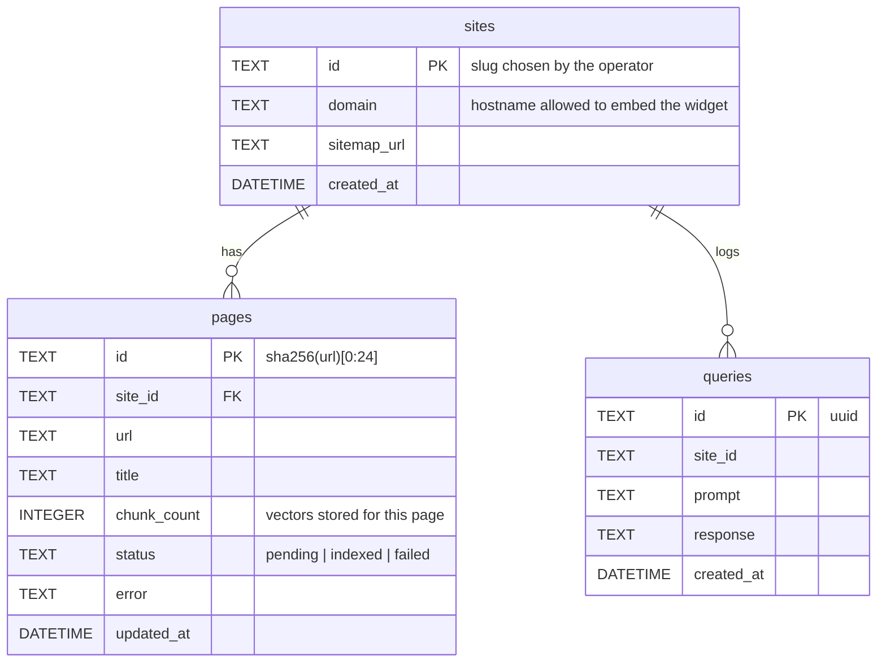
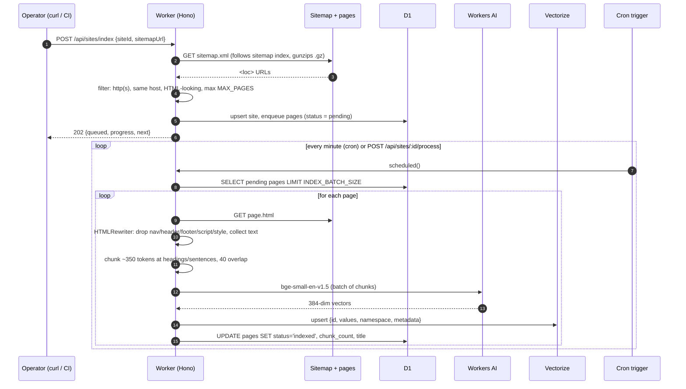
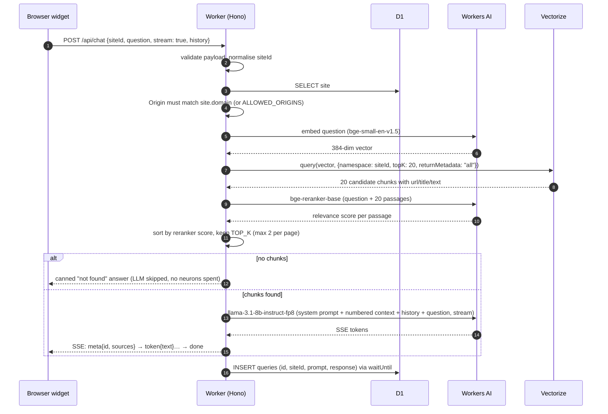

# DocFlare AI Architecture

This document explains how the pieces fit together, why the design looks the way it does, and where the free-tier constraints shaped it.

## Goals

- **Zero external dependencies at runtime.** Everything runs inside one Cloudflare Worker using only Cloudflare bindings: Workers AI, Vectorize, D1, Static Assets and Cron Triggers. No API keys to third parties.
- **Free-tier first.** Every request path must fit the Workers Free plan limits (10 ms CPU per invocation, 10k Workers AI neurons/day, 5M stored Vectorize dimensions).
- **Multi-tenant.** One deployment serves many documentation sites, each isolated and locked to its own domain.
- **Boring, auditable code.** Hono router, strict TypeScript, SQL in one file, no framework magic.

## Components

| Component               | File(s)                                        | Responsibility                                                                                                                                                        |
|-------------------------|------------------------------------------------|-----------------------------------------------------------------------------------------------------------------------------------------------------------------------|
| HTTP API + cron handler | `src/index.ts`                                 | Routing, validation, auth, SSE streaming, error mapping, scheduled entrypoint                                                                                         |
| Indexing pipeline       | `src/services/indexer.ts`                      | Sitemap → queue → crawl → chunk → embed → upsert, batch processing                                                                                                    |
| Crawler                 | `src/services/crawler.ts`                      | Sitemap parsing (incl. sitemap index + gzip), HTML text extraction with `HTMLRewriter`, token estimate, section-aware chunking                                        |
| AI                      | `src/services/ai.ts`                           | Embedding calls, cross-encoder reranking, RAG prompt, generation (sync + stream), Workers AI SSE parsing, rate-limit detection                                        |
| Vector store            | `src/services/vectorize.ts`                    | Upsert, namespace-scoped query, deletion                                                                                                                              |
| Database                | `src/db/schema.ts`, `migrations/0000_init.sql` | D1 schema, prepared statements, repository class                                                                                                                      |
| CORS / origin policy    | `src/utils/cors.ts`                            | Preflight handling, per-site domain checks                                                                                                                            |
| Widget                  | `widget/widget.src.js` → `public/widget.js`    | Shadow-DOM chat UI, SSE client, Markdown-lite renderer                                                                                                                |
| Admin UI                | `public/admin.html`                            | Static single-file page over the `/api/sites/*` endpoints: register sitemaps, progress bars, batch/loop processing, re-crawl, delete, embed snippet, recent questions |

## Bindings

```toml
[ai]              binding = "AI"            # Workers AI
[[vectorize]]     binding = "VECTOR_INDEX"  # 384-dim cosine index "docflare-index"
[[d1_databases]]  binding = "DB"            # "docflare-db"
[assets]          binding = "ASSETS"        # ./public
[triggers]        crons = ["* * * * *"]     # background indexer
```

Workers AI calls are plain `env.AI.run(model, input)` invocations; Cloudflare handles model hosting, scaling and billing. Vectorize and D1 are reached through their bindings with no network configuration.

## Data model (D1)



The `pages` table doubles as the **indexing queue**: `status = 'pending'` rows are picked up oldest-first by the cron handler. Page ids are deterministic (hash of the URL), so re-indexing is idempotent and vector ids (`<pageId>-<chunkIndex>`) can be reconstructed for deletion without storing them.

## Vector layout (Vectorize)

- Index: 384 dimensions, cosine metric, matching `@cf/baai/bge-small-en-v1.5`.
- **One namespace per site** (`namespace = siteId`). Queries are scoped with `{ namespace }`, which gives hard tenant isolation without creating a metadata index for filtering.
- Vector id: `<pageId>-<chunkIndex>`.
- Metadata (flat, < 10 KiB): `siteId`, `pageId`, `url`, `title`, `chunk`, `text`. Storing the chunk text in metadata means the chat path needs **no D1 read** to build the prompt.

## Indexing flow



### Why batches + cron instead of one big request?

The Workers Free plan caps CPU time at 10 ms per invocation. HTML parsing, chunking and JSON (de)serialisation of embedding vectors all burn CPU, so crawling a whole site in one request would be killed. Instead:

- `POST /api/sites/index` only parses the sitemap and writes the queue (cheap).
- Each cron tick or `/process` call handles `INDEX_BATCH_SIZE` pages (default 3) and returns. Network waits (fetching pages, calling Workers AI, Vectorize) do not count as CPU time.
- Failures are recorded per page (`status = 'failed'`, `error`) and never block the rest of the queue.
- A Workers AI rate limit stops the current batch early and leaves the remaining pages `pending`; the next tick retries them.

Cloudflare Queues would be the "proper" tool but are not available on the Free plan; the D1-backed queue costs nothing extra and is trivially inspectable with `wrangler d1 execute`.

### Text extraction

`HTMLRewriter` is a streaming, native (Rust) HTML parser exposed to Workers, so extracting text costs very little CPU even for large pages. The crawler:

1. Tracks a *skip depth* for boilerplate selectors (`head, script, style, noscript, template, svg, iframe, form, nav, footer, aside, body > header, [role=navigation|banner|contentinfo|search], [hidden]`), incremented on the start tag and decremented on `onEndTag`.
2. Collects text chunks under `<html>` while the skip depth is zero.
3. Inserts newlines before block-level elements so sentences from adjacent elements do not merge, and writes `<h1>`-`<h4>` as Markdown heading lines (`## Title`) that the chunker and the LLM can see.
4. Captures `<title>` (falling back to the first `<h1>`, then the URL).
5. Decodes HTML entities, normalises whitespace and caps the output at 200k characters.

### Chunking

Chunks target ~350 tokens with ~40 tokens of overlap. Sizes are measured with `estimateTokens`, a cheap upper bound of bge-small's WordPiece count (≈4.5 ASCII letters per token, ≈0.7 punctuation characters per token, one token per non-ASCII character). A fixed characters-per-token ratio does not work across scripts: Vietnamese runs at 2.3-3 characters per token, so 1,800-character chunks were silently truncated by the model's 512-token window and their tails were never searchable.

Text is split into paragraphs and sentences; units are greedily packed into a chunk, and the trailing sentences of each chunk are carried into the next one as overlap. A heading line (`## …`) starts a new chunk (without overlap) as soon as the current chunk holds `SECTION_MIN_TOKENS` (80), so a chunk rarely mixes unrelated sections of a landing page. Oversized units (long code blocks) are hard-split. The page title and meta description are prepended to the embedding input with their own token caps (40 / 80), keeping every input under 512 tokens.

## Chat flow



### Why a reranker?

Bi-encoder similarity (one vector per chunk, one per question) is cheap but coarse: a question like "open source of p10node" scores highest against chunks that repeat the site name (privacy policy, terms) rather than the paragraph that says "Open source: tooling we maintain in the open". `@cf/baai/bge-reranker-base` is a cross-encoder: it reads question and passage together and returns a relevance score, which fixes exactly this class of miss. Reranking 20 passages costs about 2 neurons and one extra round trip; if the call fails for any reason the vector order is used unchanged, so the chat path never depends on it. Set `RERANK = "false"` to turn it off.

### Prompt design

The system prompt:

- Names the site (`domain`) so the model stays in character.
- Provides the retrieved chunks as numbered excerpts, each with title and URL.
- Instructs the model to answer **only** from the excerpts, cite them inline as `[n]`, say when the answer is not in the docs, and never invent URLs/flags/versions.
- Asks for concise Markdown (lists, fenced code) which the widget renders.

The last six turns of conversation history (trimmed to 1,500 characters each) are included so follow-up questions work.

### Streaming protocol

Workers AI returns `data: {"response":"…"}` SSE lines ending in `data: [DONE]`. The Worker re-emits them as its own events so the widget never depends on Workers AI's wire format:

```
event: meta
data: {"id":"<uuid>","sources":[{"index":1,"url":"…","title":"…","score":0.82}]}

event: token
data: {"text":"Deploy with "}

event: done
data: {"id":"<uuid>"}
```

The full answer is accumulated while streaming and written to D1 after the stream closes using `ctx.waitUntil`, so logging never delays the first token.

## Multi-tenancy and security

| Concern                       | Mechanism                                                                                                                                                                                                                                                                                                                       |
|-------------------------------|---------------------------------------------------------------------------------------------------------------------------------------------------------------------------------------------------------------------------------------------------------------------------------------------------------------------------------|
| Tenant isolation in search    | Vectorize namespace per `siteId`                                                                                                                                                                                                                                                                                                |
| Who may embed the widget      | `/api/chat` compares the request `Origin` hostname with `sites.domain` (exact, `www.` variant, or `*.wildcard`), plus the `ALLOWED_ORIGINS` allow-list. Requests without an `Origin` (curl, server-side) are allowed.                                                                                                           |
| Who may index / delete        | `/api/sites/*` requires `Authorization: Bearer <ADMIN_TOKEN>`; compared in constant time. Routes return `503` if the secret is unset so a fresh deployment is never open by accident. The admin page is plain static HTML; it only becomes useful once a valid token is pasted in (kept in `sessionStorage`, never in the URL). |
| SSRF / crawling third parties | Only `http(s)` URLs whose hostname is the site's domain (or a subdomain) are queued; child sitemaps are held to the same rule.                                                                                                                                                                                                  |
| Abuse of the LLM              | Questions capped at 1,000 characters, history at 10 turns; no context → no LLM call.                                                                                                                                                                                                                                            |
| CORS                          | Preflights reflect the `Origin`; the real policy is enforced per site after the body is parsed (the site id is not known at preflight time).                                                                                                                                                                                    |
| Widget isolation              | Shadow DOM with `all: initial` on the host; nothing leaks in or out.                                                                                                                                                                                                                                                            |

## Free-tier guardrails summary

| Limit                  | How DocFlare stays under it                                                                                                             |
|------------------------|-----------------------------------------------------------------------------------------------------------------------------------------|
| 10 ms CPU / invocation | Small crawl batches, native `HTMLRewriter`, chunk text stored in vector metadata (no joins at query time)                               |
| 10k neurons / day      | Cheap embedding model, LLM skipped when retrieval is empty, `max_tokens` capped at 768, rate limits surfaced as `429` and retried later |
| 5M stored dimensions   | 384-dim model (~13k chunks); `MAX_PAGES` caps each site                                                                                 |
| D1 writes              | One write per page per crawl, one per chat                                                                                              |

## Observability

Structured JSON lines are logged for batches (`index.batch`), page failures (`index.page_failed`), rate limits (`index.rate_limited`) and unhandled errors. With `[observability] enabled = true` they are visible in the Cloudflare dashboard's Workers Logs. `GET /api/sites/:siteId/status` exposes queue counts, and the `queries` table is the analytics source for "what are people asking".

## Extension points

- **Models**: change `EMBEDDING_MODEL` / `CHAT_MODEL` in `src/services/ai.ts`. A different embedding size needs a new Vectorize index with matching dimensions.
- **Retrieval**: `TOP_K` / `RERANK` vars; swap `RERANK_MODEL` in `src/services/ai.ts`, or add hybrid keyword search (D1 FTS5) next to `searchChunks` in `src/index.ts`.
- **Ingestion**: `registerSite` accepts any URL list; add Markdown/`llms.txt` sources by extending `fetchSitemapUrls` or writing a second enqueue path.
- **Private docs**: gate `/api/chat` behind your own auth (e.g. Cloudflare Access JWT) in a Hono middleware.
